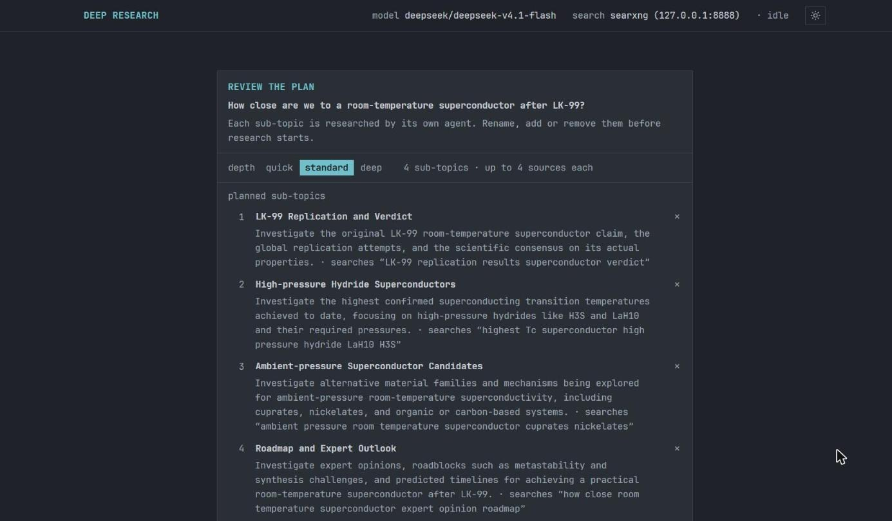
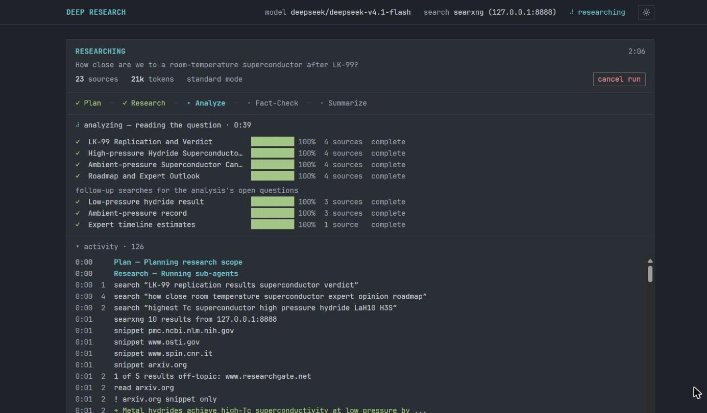
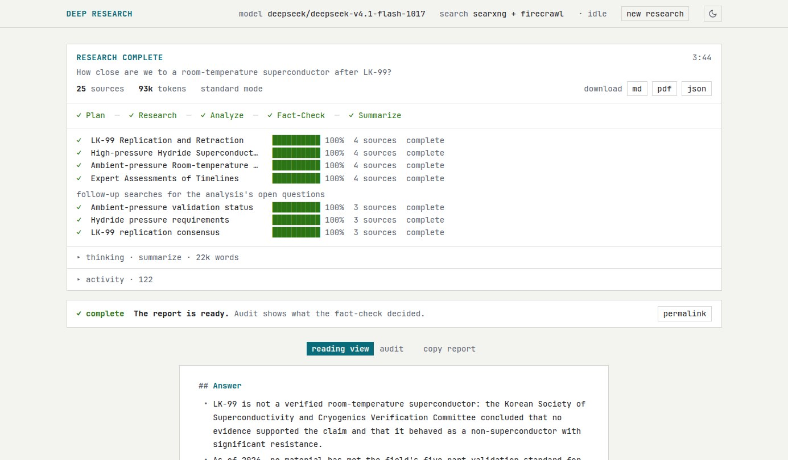
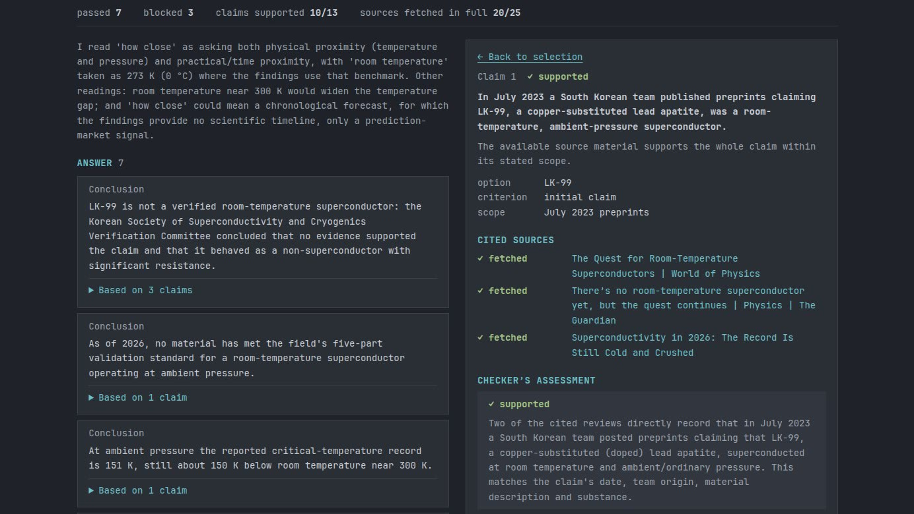

# deep-research

<div align="center">

[](https://github.com/juanhuttemann/deep-research/blob/main/go.mod)
[](https://github.com/juanhuttemann/deep-research/actions/workflows/ci.yml)
[](https://github.com/juanhuttemann/deep-research/releases)
[](https://github.com/juanhuttemann/deep-research/actions/workflows/ci.yml)
[](https://github.com/juanhuttemann/deep-research/blob/main/LICENSE)


</div>

An AI-powered deep research agent for the terminal and the browser. It plans
a question into sub-topics, researches them in parallel on the web, then runs
**research → analyze → fact-check → summarize** and writes a cited report as
Markdown, PDF and JSON. `drsh serve` opens the same run on a local
web page, with the plan to edit, the live progress, and an audit of every
claim the fact-check passed or blocked.


Running it costs nothing and needs no setup beyond one free key: the default
model is OpenRouter's free router and search goes through public SearXNG
instances.
Every source says how it was obtained, and nothing the model invents is ever
passed off as a retrieved page.

## Quick install

Linux, macOS, WSL2, Termux (installs to `~/.local/bin`):

```sh
curl -fsSL https://raw.githubusercontent.com/juanhuttemann/deep-research/main/scripts/install.sh | bash
```

Windows (native, PowerShell):

```powershell
iex (irm https://raw.githubusercontent.com/juanhuttemann/deep-research/main/scripts/install.ps1)
```

Both fetch the latest release binary and verify its checksum; see
[releases](https://github.com/juanhuttemann/deep-research/releases). After
that, `drsh update` replaces it with each new release.

From source (Go 1.26+):

```sh
git clone https://github.com/juanhuttemann/deep-research.git
cd deep-research
make build
```

The build stamps the version into a `drsh` binary in the repo root.
Move it onto your `PATH` (or run it as `./drsh`) for the examples
below.

The live terminal UI is unix-only. Windows binaries work, but the run
degrades to headless output — one log line per event, then the report.

## Quick start

```bash
drsh init          # config files, a .env template, where to get a key
```

Pick a provider and model, and paste the key (shown as `*`, stored readable
only by you). A free OpenRouter key (no card) is at <https://openrouter.ai/keys>:

```bash
drsh login
drsh -p "What are the latest advances in fusion energy?"
```

`drsh model` switches later. Environment variables still work as
the fallback: `export OPENAI_API_KEY="sk-or-..."`.

Something off? `drsh doctor` checks the model endpoint and key,
the search backend and the scraper — one cheap request each, no tokens — and
prints how many model requests a run spends.

No key at all? A run without one fails and says where to get one.

## What a run looks like

On a terminal you first get a **research brief**: the planned sub-topics,
which you can add to, rename, delete or re-budget before pressing Enter. Keys
pressed while the plan is still being made are ignored, and the brief says so.

Then a **live frame**: the pipeline stage, one row per parallel sub-agent,
the sources as they are read, and one status line for the model call in
flight — waiting for the model to start, the latest of a reasoning model's
thinking in a few rows under it, then the part of the analysis being written, claims or words so far with the
change since the last update, and "no new output for 10s" if the stream
stalls.

The **report** is rendered in the terminal and saved to `reports/` as `.md`,
`.pdf` and `.json`. Besides the answer it carries:

- the model that wrote it — the configured one, and which models a router
  actually served;
- the answer first: for a choice, which option to pick under which
  conditions, then a comparison of the options and the reasoning, each
  claim linked to its source;
- the limits that could change the answer, and searches that could settle
  them;
- the fact-check: how many claims were confirmed, and each one that was not
  confirmed or was contradicted;
- citations split into sources the report cites and sources it only read,
  each source not read in full marked `snippet only` (the search snippet was
  all it gave) or `never fetched` (model-supplied); a page read in full is
  left unmarked.

If the analysis or the report call fails late in a run — a provider error, or
the run deadline — what was gathered is still saved and exported, marked
incomplete, and the command exits non-zero. The same goes for a run where more
searches gave nothing than gave something (refused, or answered with only
off-topic results): its report opens by saying so and how many sources it
rests on, with confidence `low`. With fewer than three sources such a run
stops before the analysis instead, saying why.

### In the browser

`drsh serve` runs the same pipeline from a page on localhost, styled
after the terminal UI, in a light or a dark theme, and opens it in your
browser. You type the question and pick the depth, then edit the plan before
anything is searched: rename, add or remove sub-topics, and change the search
each one runs:



The live frame shows the pipeline, each sub-agent with its sources, the
follow-up searches the analysis asked for, and the model's reasoning as it
streams: its latest lines under the status, and all of it, call by call, in a
thinking block you can open:



When the run ends, the report opens below it without its citation marks, with
the `.md`, `.pdf` and `.json` downloads in the header (here in the light
theme):



The audit shows what the fact-check decided: the statements that passed, the
ones it blocked, every claim with its verdict, and for each verdict the quote
it rests on and the page it was found in:



## Search

| Setting (`SEARXNG_URL`) | What happens |
| ----------------------- | ------------ |
| unset (`auto`) — the default | public SearXNG instances from [searx.space](https://searx.space/), tried in turn; the one that answers is used first next time |
| your instance(s), comma-separated | your own SearXNG; add `FIRECRAWL_URL` to scrape full page text instead of snippets |
| `off` | no search: the model proposes findings from memory, every source is `~ unverified`, and the fact-check runs as a self-consistency pass |

Public instances mostly refuse SearXNG's JSON API, so their HTML result page
is read instead. A search that is refused — rate limit, bot challenge,
outage — is reported with that reason; it is never quietly replaced by
findings the model makes up, and a run whose every search failed stops
instead of writing a report about nothing.

With `auto`, every query goes to a third party you did not pick. To keep
queries on your machine:

```bash
drsh init --docker   # sets up SearXNG and points the config at it
docker compose -f ~/.config/deep-research/docker-compose.yml up -d
drsh doctor          # confirms it answers
```

This is the recommended setup: public instances often refuse a run's
searches partway through. It also turns on more engines than SearXNG's
default three. Engines rate-limit by IP address, so a local SearXNG can
still be throttled after many searches; more engines means one engine's
limit rarely leaves a search unanswered. A run cut short by a limit can be
finished later with `--resume`, which repeats only the searches that
failed.

Firecrawl, for full page text, runs from its own repository:
[docs/services.md](docs/services.md).

## Models

`openrouter/free` costs nothing and picks an available free model per request,
so runs are not reproducible model-for-model — which is why every report
records what served it. Free models are capped per minute and per UTC day; a
run is 4 to 7 model requests with search (plan, analyze, a second analyze
when follow-up searches found evidence, fact-check, a revision and its
check when a recommendation was blocked, summarize). With search off, the
worst-case budgets before retries are quick 19, standard 21 and deep 25,
as printed by `doctor`. Hitting the daily cap fails at once with a message
instead of burning retries; a per-minute limit waits for the provider's
`Retry-After`.

`drsh login` lists the providers it can drive — OpenRouter, OpenAI,
Anthropic and some thirty OpenAI- or Anthropic-compatible ones, from
[Catwalk](https://github.com/charmbracelet/catwalk)'s catalog — and a custom
endpoint for a local vLLM, llama.cpp or LM Studio server, which needs no key.
Without login, set `OPENAI_BASE_URL` and `OPENAI_MODEL`.

Or Claude: `DEEP_RESEARCH_PROVIDER=claude` runs on your Claude subscription
through Claude Code when it is signed in (`claude auth login`), and on
`ANTHROPIC_API_KEY` otherwise or once the subscription's limit is reached.
See [Claude](docs/configuration.md#claude).

## Common commands

```bash
drsh -p "question" --mode deep          # quick | standard | deep
drsh -p "question" --output report.md   # also save to a file
drsh -p "question" --silent             # just the report
drsh -p "question" --jsonl              # machine-readable events
drsh serve                               # launch and audit runs in the browser
drsh --resume reports/<run>.partial.json # continue an interrupted run
drsh list                                # past runs
drsh login                               # pick provider + model, store the key
drsh model                               # switch provider or model
drsh doctor                              # check model, key, search
drsh init --docker                       # local SearXNG setup
drsh update                              # install the latest release
```

Full flag reference, key bindings and export details: [docs/usage.md](docs/usage.md).

## Use it from an agent

The repo ships an [Agent Skill](skills/deep-research/SKILL.md) that teaches a
coding agent to run `drsh`, wait for the result and report the
fact-checked answer with its sources. The binary must be installed first.

Claude Code:

```
/plugin install deep-research --marketplace juanhuttemann/deep-research
```

(Before Claude Code 2.1.275: `/plugin marketplace add juanhuttemann/deep-research`,
then `/plugin install deep-research@deep-research`.)

Codex, Cursor, Gemini CLI, OpenCode and other agents that read Agent
Skills (and Claude Code too):

```sh
npx skills add juanhuttemann/deep-research
```

Or copy `skills/deep-research/` into the agent's skills directory.

## Configuration

Settings resolve environment > what `drsh login` picked >
`config.yaml` > embedded defaults, and every `config.yaml` key is also
settable as `DEEP_RESEARCH_<KEY>`. A key stored by `login` wins over the
environment's. `config.yaml` and `.env` are read from one place,
`~/.config/deep-research/` (`$DEEP_RESEARCH_CONFIG_DIR` when set), whatever
folder a run starts in.

| Env var | Meaning | Default |
| ------- | ------- | ------- |
| `OPENAI_API_KEY` | LLM API key, when `login` stored none | — (required) |
| `OPENAI_BASE_URL` | LLM endpoint | `https://openrouter.ai/api/v1` |
| `OPENAI_MODEL` | model to use | `openrouter/free` |
| `DEEP_RESEARCH_PROVIDER` | `openai`, or `claude` for Claude Code / `ANTHROPIC_API_KEY` | `openai` |
| `SEARXNG_URL` | a URL, a comma-separated list, `auto` or `off` | `auto` |
| `FIRECRAWL_URL` | Firecrawl instance for page scraping | — (snippets only) |

Timeouts, retries, parallelism, history location, the legacy `OPENROUTER_*`
names and the trust boundaries for scraping and public search are in
[docs/configuration.md](docs/configuration.md).

## Development

```bash
make verify   # fmt, vet, lint, deadcode, go test -race — the gate
make tools    # installs the lint binaries
```

Conventions, test style and the rules a change has to respect are in
[CONTRIBUTING.md](CONTRIBUTING.md) and [docs/architecture.md](docs/architecture.md);
cutting a release is [RELEASING.md](RELEASING.md). Notable changes are
recorded in [CHANGELOG.md](CHANGELOG.md).

## License

MIT — see [LICENSE](LICENSE).
