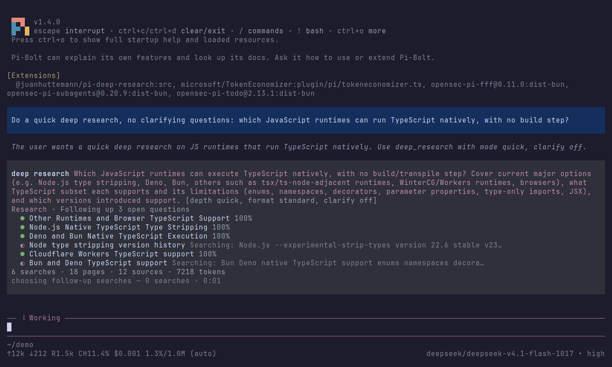

# @juanhuttemann/pi-deep-research

Fact-checked, cited web research inside [Pi](https://pi.dev). The extension
runs [deep-research](https://github.com/juanhuttemann/deep-research)
(`drsh`): it plans sub-topics, searches them in parallel, analyzes the
evidence, and checks every claim against the text of the pages it fetched.
Pi's own model answers the model calls, through Pi's sign-in.



## Install

`drsh` must be installed (0.30.0 or newer):

```sh
curl -fsSL https://raw.githubusercontent.com/juanhuttemann/deep-research/main/scripts/install.sh | bash
```

Then:

```sh
pi install npm:@juanhuttemann/pi-deep-research
```

From a clone, `pi install ./integrations/pi`. For one session,
`pi -e ./integrations/pi/src/index.ts`.

drsh's search and scraper settings still apply. SearXNG works with no
setup, while Exa, Tavily and Firecrawl use their keys from `drsh setup`.
`/research-doctor` checks them.

## What it adds

- **`deep_research` tool.** Ask Pi to research something.
  - While the run goes, the call shows the phase, each sub-agent, the
    searches, pages and sources so far, and the model's reasoning.
  - When it ends, the call shows the confidence, the fact-check's verdicts,
    the claims it did not confirm, and the report's path.
  - Esc stops a run. It keeps a checkpoint, and resuming from it skips the
    searches already done.
  - When the question leaves something open, the clarifying questions open
    as Pi dialogs. In print or JSON mode they go back to the model, which
    asks you.
  - Every run setting drsh has is a tool parameter: depth (instant, quick,
    standard, deep), sub-topics, pages per topic, follow-ups, format,
    words, tables and clarify. `domains`, `trace` and `review_plan`
    (review and edit the plan before any search) are parameters too. The
    settings come from `drsh settings`, so a new setting in drsh appears
    here with no update.
- **`research_ask` tool.** Answers a follow-up question from the pages a
  run already fetched, without searching again. The answer is not
  fact-checked.
- **`/research [--topics 3 --follow-ups off --domains a,b …] question`**
  runs a research yourself.
  - With no flags it opens the settings screen first.
  - You answer the clarifying questions and review the plan, then the run
    starts and the agent reports what it found.
  - `/research-stop` ends the run.
- **`/research-model`** picks the model research runs use:
  - Pi's current model, the default.
  - Another of Pi's models, for example a cheaper one for the many calls a
    run makes.
  - drsh's own configured model.
- **`/research-doctor`** checks the model (through Pi), search and the
  scraper.

Each run's files (`.md`, `.pdf`, `.json`, checkpoint) go in
`~/.cache/deep-research-pi/runs/` (`$DEEP_RESEARCH_PI_RUNS` to change it),
never into your project. `DRSH_BIN` points to a `drsh` that is not on
`PATH`.

## How the model is reached

For each call, the extension starts an HTTP endpoint on `127.0.0.1` that
speaks the OpenAI chat-completions API. The endpoint accepts only a random
token, given to drsh as its API key, and closes when the call ends.

drsh runs with `OPENAI_BASE_URL` pointed at that endpoint, and each request
it sends is answered by `ctx.modelRegistry.streamSimple`. Streamed
reasoning, JSON mode, tool calls (for `research_ask`) and usage all pass
through. The run's usage is added to the tool result, so Pi's session
totals count it.

## Development

```sh
npm ci
npm run typecheck
DRSH_BIN=/path/to/drsh npm test   # bridge tests run that drsh offline
```

From the repo root, `make pi` builds drsh from the tree and runs all three.
