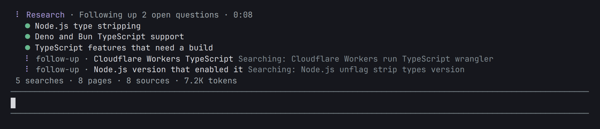
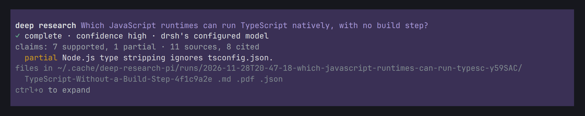
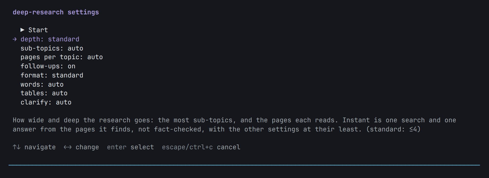
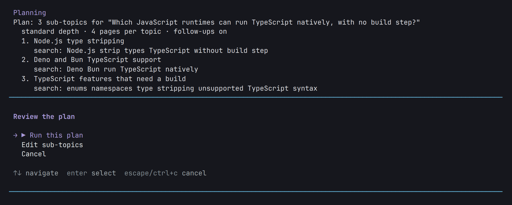

# @juanhuttemann/pi-deep-research

Fact-checked, cited web research inside [Pi](https://pi.dev). The extension
runs [deep-research](https://github.com/juanhuttemann/deep-research)
(`drsh`): it plans sub-topics, searches them in parallel, analyzes the
evidence, and checks every claim against the text of the pages it fetched.
Pi's own model answers the model calls, through Pi's sign-in.



## Install

`drsh` must be installed (0.30.0 or newer):

```sh
curl -fsSL https://raw.githubusercontent.com/juanhuttemann/deep-research/main/scripts/install.sh | bash
```

Then:

```sh
pi install npm:@juanhuttemann/pi-deep-research
```

From a clone, `pi install ./integrations/pi`. For one session,
`pi -e ./integrations/pi/src/index.ts`.

drsh's search and scraper settings still apply. SearXNG works with no
setup, while Exa, Tavily and Firecrawl use their keys from `drsh setup`.
`/research-doctor` checks them.

## Ask Pi

Ask Pi to research something, and it calls the `deep_research` tool. A run
takes minutes and makes many model calls, so Pi uses it for questions that
need sources, not quick lookups.

- **While it runs**, the call shows the phase with a spinner and its clock,
  what the model is doing, each sub-agent and its search (follow-ups
  marked), and the searches, pages and sources so far. Once the search is
  over, the sub-agents fold into one line, and the fact-check shows its
  tally when it has one.
- **When it ends**, the call shows the result: the confidence, the claims
  as the run concluded them, the ones the fact-check did not confirm, and
  the folder the run's files are in. Ctrl+O expands it to every claim and
  each file's full path. Pi then answers from the report, keeping its
  citations.

  

- **Esc stops a run.** It keeps a checkpoint, and resuming from it skips
  the searches already done.
- **Clarifying questions**, when the question leaves something open, open
  as Pi dialogs. In print or JSON mode they go back to the model, which
  asks you.

Every run setting drsh has is a tool parameter: depth (instant, quick,
standard, deep), sub-topics, pages per topic, follow-ups, format, words,
tables and clarify. `domains`, `trace` and `review_plan` (review and edit
the plan before any search) are parameters too. The settings come from
`drsh settings`, so a new setting in drsh appears here with no update.

For a follow-up, Pi uses the `research_ask` tool: it answers from the pages
a run already fetched, without searching again. Its answers are not
fact-checked.

## Run it yourself

`/research question` runs a research from the prompt.

1. **Settings.** With no flags, the settings screen opens first. ←/→ steps
   the setting under the cursor through its values, Enter lists them all,
   and the line under the list says what the setting does. Flags skip it:
   `/research --mode quick --follow-ups off --domains a.com,b.org question`.

   

2. **Questions.** You answer the clarifying questions, if any.
3. **Plan.** You review the plan: its depth, pages per topic, follow-ups,
   and the search each sub-topic starts from. Run it, edit the sub-topics
   (one per line), or cancel. An edit past drsh's sub-topic limit is
   refused here. An instant run has no plan review: it searches the
   question as asked.

   

4. **Run.** The run shows above the prompt as the tool's does, and ends in
   the same result, with the tokens it used. Pi then reports what it found.

| Command | What it does |
| --- | --- |
| `/research [flags] question` | Runs a research, as above. |
| `/research-stop` | Ends the `/research` run, keeping a checkpoint. |
| `/research-resume [checkpoint]` | Continues the last stopped, failed or incomplete run, or the checkpoint given, without repeating finished searches. A run stopped before drsh's first checkpoint starts again with the same question, settings and answers, and the plan you approved, edits included. |
| `/research-model` | Picks the model runs use: Pi's current model (the default), another of Pi's models (a cheaper one, say, for the many calls a run makes), or drsh's own configured model. Type to filter the list. |
| `/research-doctor` | Checks the model (through Pi), search and the scraper. |

## Files

Each run's files (`.md`, `.pdf`, `.json`, checkpoint) go in
`~/.cache/deep-research-pi/runs/` (`$DEEP_RESEARCH_PI_RUNS` to change it),
never into your project. `DRSH_BIN` points to a `drsh` that is not on
`PATH`.

## How the model is reached

For each call, the extension starts an HTTP endpoint on `127.0.0.1` that
speaks the OpenAI chat-completions API. The endpoint accepts only a random
token, given to drsh as its API key, and closes when the call ends.

drsh runs with `OPENAI_BASE_URL` pointed at that endpoint, and each request
it sends is answered by `ctx.modelRegistry.streamSimple`. Streamed
reasoning, JSON mode, tool calls (for `research_ask`) and usage all pass
through. The run's usage is added to the tool result, so Pi's session
totals count it.

## Development

```sh
npm ci
npm run typecheck
DRSH_BIN=/path/to/drsh npm test   # bridge tests run that drsh offline
```

From the repo root, `make pi` builds drsh from the tree and runs all three.
